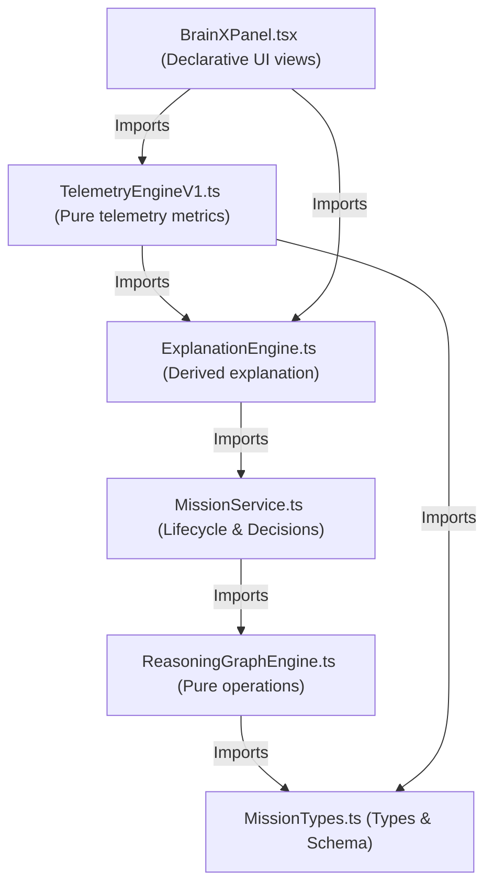

# Brain X Dependency Map

This map defines the strict dependency direction within the Brain X cognitive layer, preventing circular references and maintaining boundary isolation.

---

## Diagram

---

## Layer Rules

1. **Dependency Direction**: Downward imports are strictly prohibited. The UI depends on Telemetry and Explanation, which depend on Cognition, which depend on core types.
2. **Pure Engines**: `ReasoningGraphEngine` and `TelemetryEngine` are purely functional libraries with zero side effects, enabling 100% test coverage.
