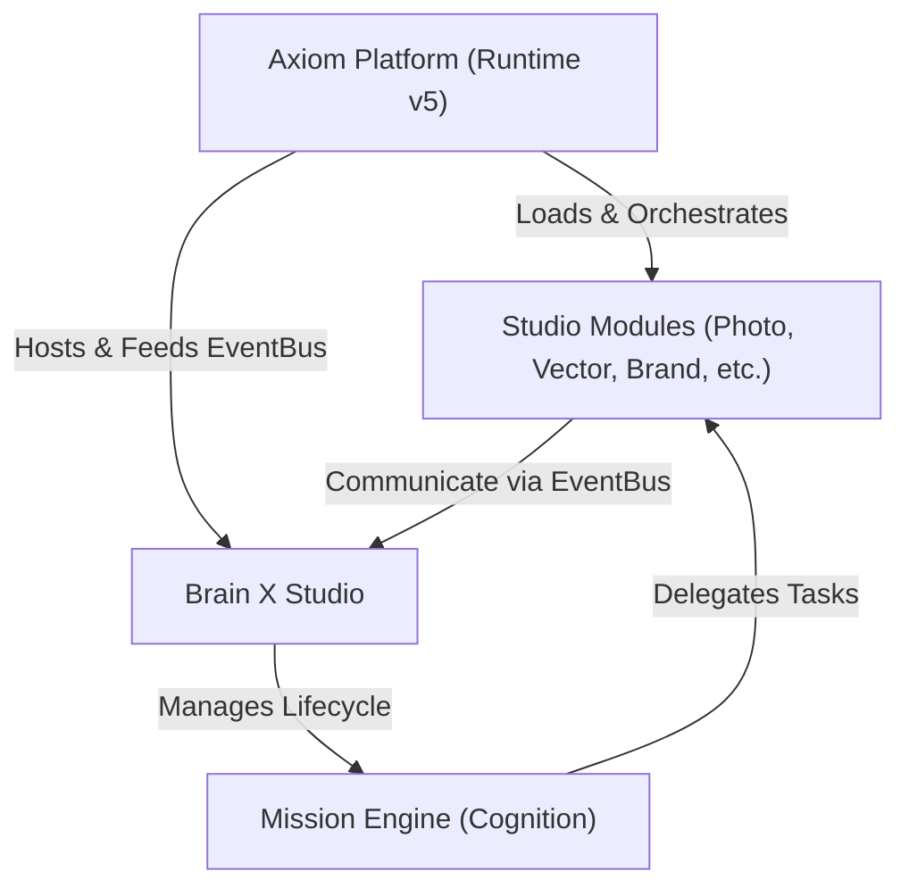

# Brain X Runtime Map

This map defines the execution flow and authority layers between the Axiom Platform, Studio modules, and the Brain X cognitive subsystem.

---

## Diagram

---

## Execution Flow

1. **Axiom Platform (Runtime v5)** loads and initializes the system, setting up the `EventBus` and core state containers.
2. **Studios** register as modular extensions via the `StudioModule` API.
3. **Brain X Studio** initializes as a cognitive management module, subscribing to orchestration events.
4. **Mission Engine** executes intent, builds the reasoning graph, and delegates tasks back to specific **Studios** via EventBus commands.
