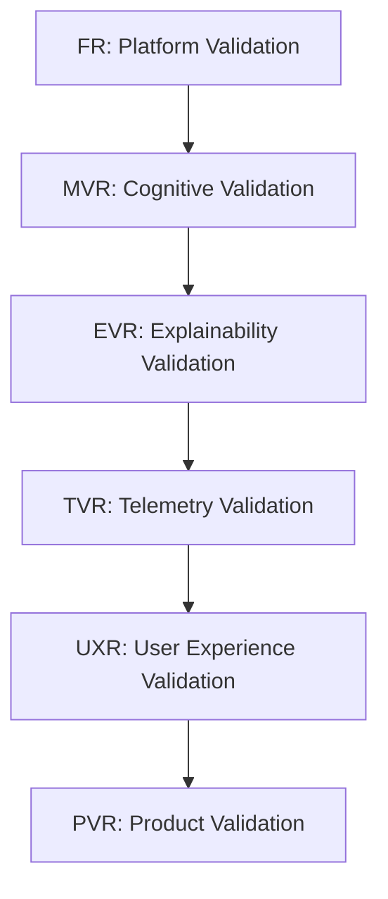

# Brain X Validation Ladder

This document defines the canonical engineering validation gates for every studio and subsystem in Axiom.

---

## Diagram

---

## Validation Gate Details

### 1. FR (Platform Validation)
* **Purpose**: Verify engineering contracts, modular loading, and EventBus stability.
* **Owner**: Platform Division.
* **Entry Criteria**: App shell scaffold compiles; package.json configured.
* **Exit Criteria**: Modules load successfully; EventBus events propagate with $< 50\text{ms}$ latency.
* **Evidence Required**: Green `npm run test` on core platform components.

### 2. MVR (Cognitive Validation)
* **Purpose**: Verify reasoning graph logic, topological sorting, and delegation flows.
* **Owner**: Cognition Layer.
* **Entry Criteria**: FR passes; `MissionTypes.ts` schema complete.
* **Exit Criteria**: Graph operations execute without cycles; promotion evidence consolidates accurately.
* **Evidence Required**: All Mission Diversity Index scenarios pass (e.g. `MVR2_MissionDiversity.test.ts`).

### 3. EVR (Explainability Validation)
* **Purpose**: Verify that derived explanation contracts map accurately to backend cognitive state.
* **Owner**: Explainability Layer.
* **Entry Criteria**: MVR passes; `ExplanationContractV1` defined.
* **Exit Criteria**: Explanation contract fields match internal state across all lifecycle stages.
* **Evidence Required**: Complete test coverage in `EVR1_ExplanationCorrectness.test.ts`.

### 4. TVR (Telemetry Validation)
* **Purpose**: Verify telemetry snapshot purity, determinism, and correctness of CLS, MCS, and CTS metrics.
* **Owner**: Telemetry Layer.
* **Entry Criteria**: EVR passes; `TelemetryEngineV1` defined.
* **Exit Criteria**: Telemetry snapshot generation is synchronous, side-effect free, and deterministic.
* **Evidence Required**: Unit tests verifying load thresholds and consistency mathematics.

### 5. UXR (User Experience Validation)
* **Purpose**: Verify that human operators understand the timeline, reasoning, and predicted actions.
* **Owner**: Experience Layer.
* **Entry Criteria**: TVR passes; `BrainXPanel` UI implementation complete.
* **Exit Criteria**: Users can correctly deduce next actions and trust score indicators.
* **Evidence Required**: User study reports showing $> 85\%$ comprehension rates.

### 6. PVR (Product Validation)
* **Purpose**: Verify task completion speed, intervention frequency, and user workflow adoption.
* **Owner**: Product Division.
* **Entry Criteria**: UXR passes; studio integrated into Workspace Hub.
* **Exit Criteria**: Reduction in time-to-outcome; active product engagement.
* **Evidence Required**: Live product analytics showing task completion rate improvements.
