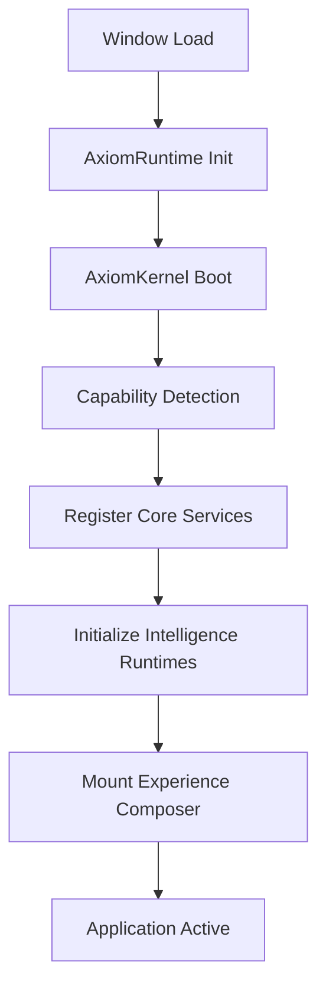

# Axiom Technical Architecture

This document outlines the technical specifications of the Axiom Creative Platform Runtime (v5). It covers startup lifecycles, service composition, message transport, and rendering abstractions.

---

## 1. Bootstrapping & Lifecycle

The Axiom Platform lifecycle is orchestrasted by the `AxiomKernel`. 



### Kernel Responsibilities:
- **Startup Sequence**: Runs hardware capability checks, detects touch interfaces, handles offline support, and logs startup times.
- **Dependency Injection**: Orchestrates service lookups so runtimes and components can fetch system instances without direct circular imports.
- **Health Verification**: Runs telemetry audits and marks modules as active, degraded, or suspended.

---

## 2. Platform Services & APIs

All client components and studios interact with the platform through services:
- **Event Bus (`eventBus.ts`)**: A global publisher-subscriber channel. Every user interaction (scrolling, clicking, hovering) emits semantic events.
- **State Service (`stateService.ts`)**: Acts as the central store for project layers, active views, user sessions, and preferences.
- **Capability Service (`capabilityService.ts`)**: Exposes hardware and engine profiles (e.g. WebGL support, GPU benchmark, screen resolution, offline status).
- **Platform API (`api.ts`)**: Protects direct file read/write operations and registry structures (assets, templates, connectors, subscriptions).

---

## 3. Experience System

Axiom interfaces are completely configuration-driven, separating definition from presentation.

```
+---------------------------------------+
|          landing.manifest.ts          |
|  (Lists scroll sections & cameras)    |
+---------------------------------------+
                   |
                   v
+---------------------------------------+
|          ExperienceComposer           |
| (Resolves manifests & design tokens)   |
+---------------------------------------+
        /                           \
       v                             v
+-------------+               +--------------+
|   React UI  |               |  WebGL Scene |
+-------------+               +--------------+
```

### Experience Director:
Synchronizes timeline scrolling to:
1. Interpolate WebGL camera coordinates across named coordinates.
2. Toggle active lighting configurations, environment effects (fog, particle densities), and custom shaders.
3. Trigger sound transitions and navigation transformations.

---

## 4. Rendering Abstraction

To ensure long-term flexibility, the platform core is decoupled from WebGL dependencies:
- **Scene Graph**: An internal node-based data structure defining shapes, positions, scales, and materials.
- **Rendering Service**: Acts as the intermediary API translating scene graph elements into draw calls.
- **ThreeRenderer**: The default WebGL implementation. If rendering capabilities are limited, it gracefully switches to a standard 2D HTML Canvas renderer.
